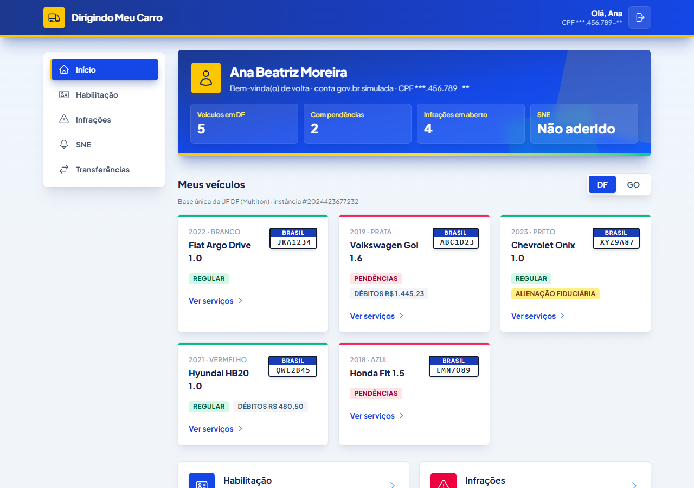
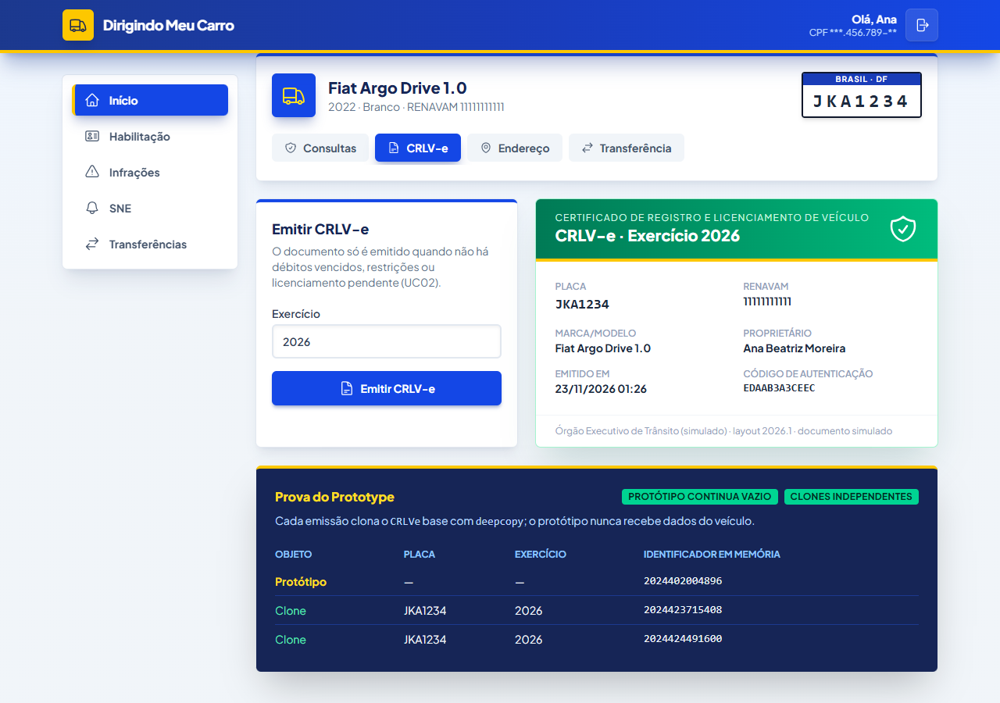
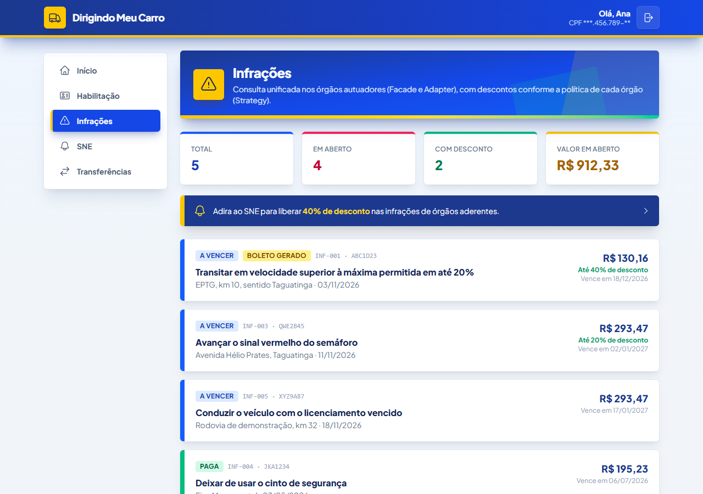
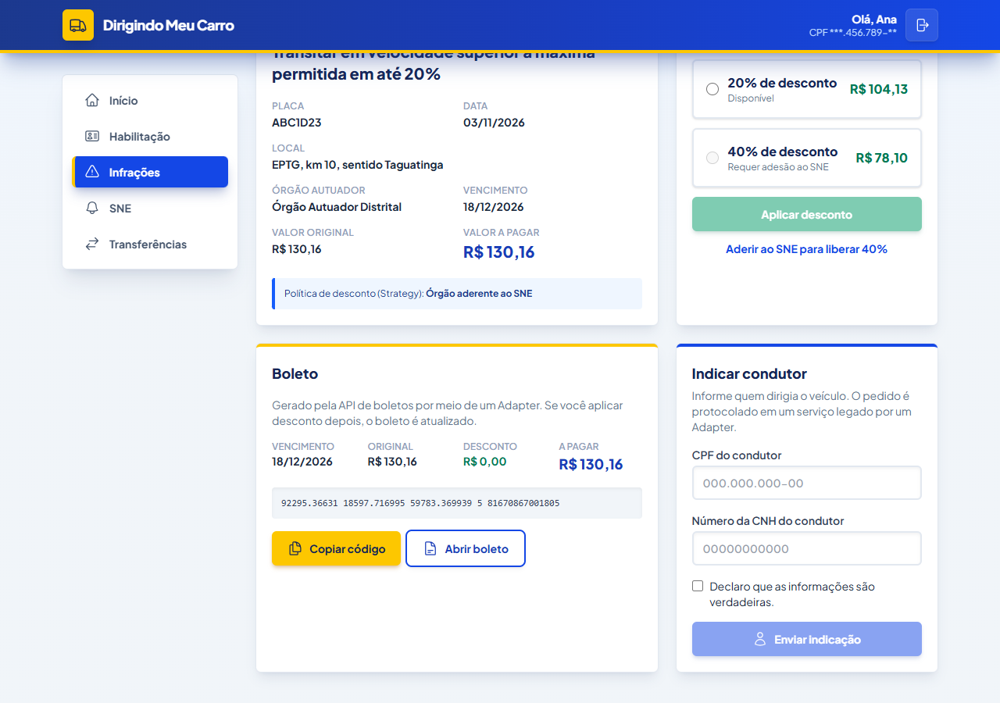
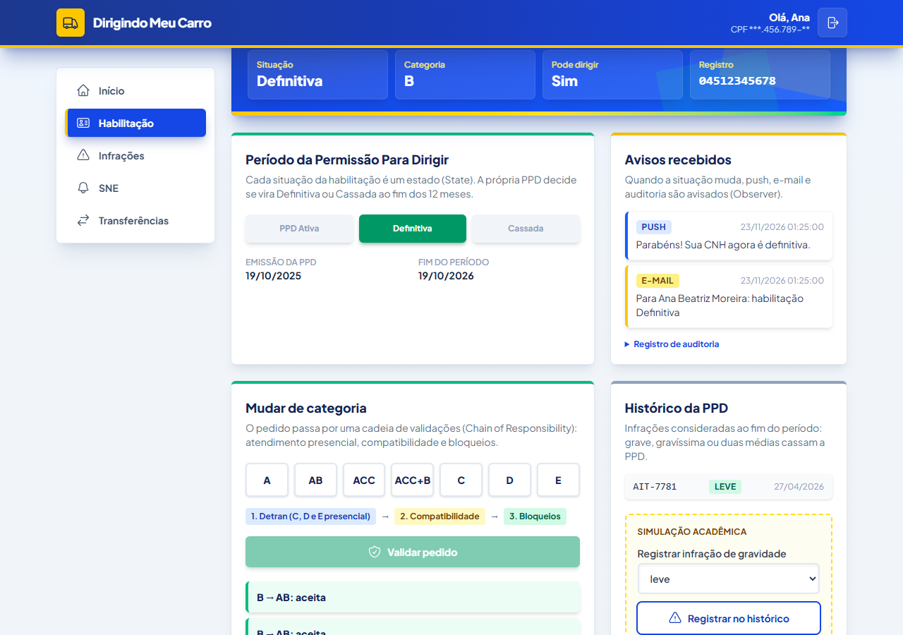
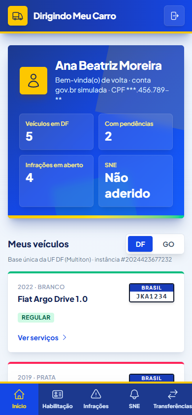

# Dirigindo Meu Carro

**Código da Disciplina**: FGA0208 
**Número do Grupo**: Dirigindo Meu Carro 
**Entrega**: 04 

## Alunos
|Matrícula | Aluno |
| -- | -- |
| 23/2025730  |  [Edson Pereira Roldão Filho](https://github.com/edso-n) |
| 23/1012100  |  [Felipe Henrique Oliveira Sousa](https://github.com/fhenrique77) |
| 24/1025336  |  [Matheus Pinheiro](https://github.com/matheus-06) |
| 23/1037727 |  [Ricardo Henrique Silva Rodrigues](https://github.com/R1K4S) |
| 23/2007016  |  [Yuri Souza de Andrade Castro Silva](https://github.com/y123yuri) |

## Sobre 
Esta entrega consolida as Entregas [01](https://unbarqdsw2026-2-turma02.github.io/2026.2-T02-_G6_ProjetoAplicativoMovel_Entrega01/), [02](https://unbarqdsw2026-2-turma02.github.io/2026.2-T02-_G6_ProjetoAplicativoMovel_Entrega02/) e [03](https://unbarqdsw2026-2-turma02.github.io/2026.2-T02-_G6_ProjetoAplicativoMovel_Entrega03/#/) no [Documento de Arquitetura de Software](/Base/Relatorios/1.1.1.DAS.md) do recorte estudado do aplicativo DETRAN-DF Digital e entrega um [aplicativo executável (MVP)](/Base/Relatorios/1.1.3.AplicativoMVP.md) que materializa a arquitetura proposta, com os padrões Multiton, Factory Method, Prototype, Adapter, Facade, Strategy, State, Observer e Chain of Responsibility.

## Screenshots da Quarta Entrega

Telas do [aplicativo executável (MVP)](/Base/Relatorios/1.1.3.AplicativoMVP.md) desenvolvido nesta entrega.

<strong>Figura 1</strong> - Login gov.br simulado

<em>Fonte: captura do MVP da Entrega 04, com dados simulados.</em>

<strong>Figura 2</strong> - Início com os veículos da base do DF (Multiton)

<em>Fonte: captura do MVP da Entrega 04, com dados simulados.</em>

<strong>Figura 3</strong> - Emissão do CRLV-e e prova do Prototype

<em>Fonte: captura do MVP da Entrega 04, com dados simulados.</em>

<strong>Figura 4</strong> - Infrações com resumo e descontos (Facade, Adapter e Strategy)

<em>Fonte: captura do MVP da Entrega 04, com dados simulados.</em>

<strong>Figura 5</strong> - Detalhe da infração com boleto e indicação de condutor (Adapter)

<em>Fonte: captura do MVP da Entrega 04, com dados simulados.</em>

<strong>Figura 6</strong> - Habilitação com State, Observer e Chain of Responsibility

<em>Fonte: captura do MVP da Entrega 04, com dados simulados.</em>

<strong>Figura 7</strong> - Versão para celular, com navegação inferior

<em>Fonte: captura do MVP da Entrega 04, com dados simulados.</em>

## Há algo a ser executado?

(X) SIM

( ) NÃO

O MVP fica na pasta `aplicativo/`. Com o [Python 3.10 ou superior](https://www.python.org/downloads/) instalado:

- **Windows:** dois cliques em `executar.bat`, na raiz do repositório;
- **Linux ou macOS:** `./executar.sh` no terminal.

O script instala o necessário e abre o aplicativo em <http://127.0.0.1:8000>. Depois, é só clicar em **Entrar com gov.br** (login simulado). Também é possível usar o Docker: `docker compose up --build`. O manual completo está na página [1.1.3. Aplicativo (MVP)](/Base/Relatorios/1.1.3.AplicativoMVP.md).

## Informações Complementares 
Quaisquer outras informações adicionais podem ser descritas nessa seção.

## Histórico de Versão

| Versão |    Data    | Alterações                           | Autor |
| :----: | :--------: | ------------------------------------ | ----- |
|  1.0 | 04/11/2026 | Criação do esqueleto inicial a partir do template da disciplina| [Edson](https://github.com/edso-n)|
|  1.1 | 22/11/2026 | Seção Sobre e manual de execução do MVP | [Yuri](https://github.com/y123yuri)|
|  1.2 | 23/11/2026 | Novos padrões do MVP, execução com um clique e screenshots das telas | [Yuri](https://github.com/y123yuri)|

